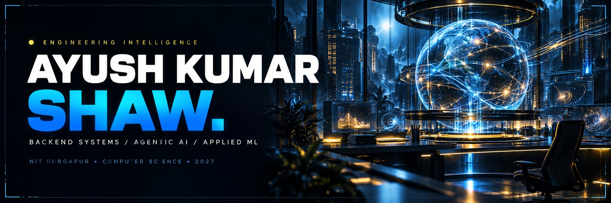
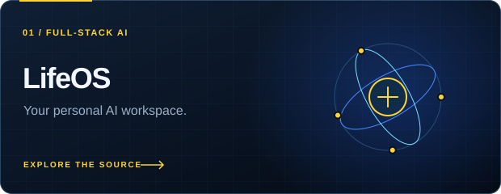
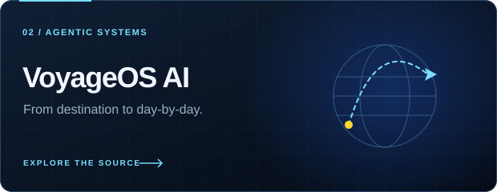
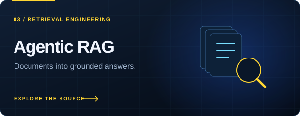
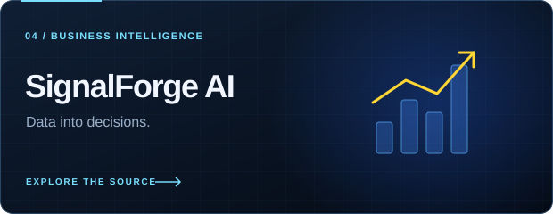
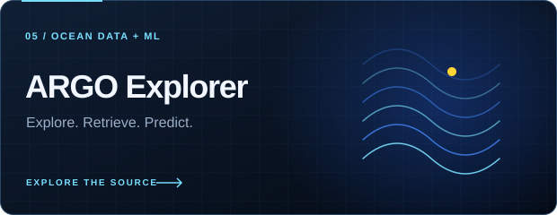
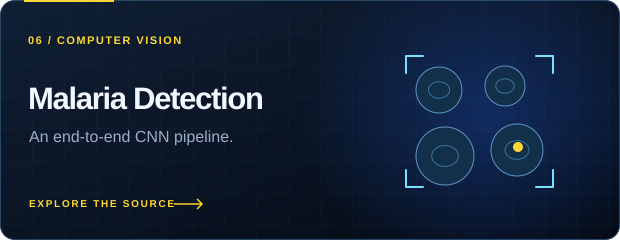

<!-- Profile repository: ayushaks9990/ayushaks9990. Upload assets/ with this README. -->

  
  
  
  

  <b>Software engineer building intelligent products.</b> 
  Computer Science @ NIT Durgapur · Class of 2027 · Open to internships &amp; collaborations

  <a href="#about-me">About</a> &nbsp; / &nbsp;
  <a href="#selected-projects">Projects</a> &nbsp; / &nbsp;
  <a href="#tech-stack">Tech stack</a> &nbsp; / &nbsp;
  <a href="#achievements--education">Achievements</a> &nbsp; / &nbsp;
  <a href="#lets-connect">Contact</a>

## About me

I’m **Ayush Kumar Shaw**, a **B.Tech Computer Science undergraduate at NIT Durgapur**, building backend systems, full-stack AI products, and applied ML solutions.

I enjoy owning the complete engineering process: **architecture → implementation → evaluation → deployment**. My work brings together APIs, authentication, databases, retrieval, agent workflows, and interfaces that make complex systems useful.

- **Backend engineering:** REST APIs, authentication, persistent storage, streaming, and modular services.
- **AI systems:** Agentic RAG, multi-agent workflows, semantic search, reranking, and grounded answers.
- **Applied ML:** Forecasting, classification, computer vision, and reproducible evaluation pipelines.
- **CS fundamentals:** Data structures, algorithms, system design, and competitive programming.

  

## Selected projects

**Full-stack AI, agentic systems, retrieval, and applied machine learning.**

<table>
<tr>
<td width="50%" valign="top">

<h3>LifeOS</h3>

<b>Personal AI operating system</b>

One workspace for assistant chat, memory, tasks, goals, planning, reminders, and finance.

<ul>
<li>Gmail, Calendar, and connected integrations</li>
<li>Music and voice interaction</li>
<li>JWT and OAuth 2.0 authentication</li>
</ul>

<code>FastAPI</code> <code>React</code> <code>PostgreSQL</code> <code>Redis</code> <code>Groq</code> <code>Docker</code>

<a href="https://github.com/ayushaks9990/LifeOSs"><b>Explore LifeOS →</b></a>

</td>
<td width="50%" valign="top">

<h3>VoyageOS AI</h3>

<b>Autonomous travel copilot</b>

An AI vacation planner that turns a source, destination, and preferences into a complete trip.

<ul>
<li>Multi-agent planning and destination recommendations</li>
<li>Flight and hotel discovery, with budget optimization</li>
<li>Personalized day-by-day itineraries</li>
</ul>

<code>FastAPI</code> <code>React</code> <code>Groq</code> <code>Google Places</code> <code>Amadeus</code> <code>PostgreSQL</code> <code>Docker</code>

<a href="https://github.com/ayushaks9990/Voyageos"><b>Explore VoyageOS AI →</b></a>

</td>
</tr>
<tr>
<td width="50%" valign="top">

<h3>Agentic Multi-PDF RAG</h3>

<b>Retrieval with grounding and feedback</b>

A multi-user document QA platform with persistent conversations, semantic retrieval, and streaming answers.

<ul>
<li>Token-aware PDF ingestion and optional OCR</li>
<li>Feedback-driven reranking and experimental visual reranking</li>
<li>Source snippets, web fallback, and deployment support</li>
</ul>

<code>Python</code> <code>Streamlit</code> <code>LangChain</code> <code>Gemini</code> <code>ChromaDB</code> <code>SQLite</code> <code>Docker</code> <code>Azure</code>

<a href="https://github.com/ayushaks9990/RaG_Chatbot"><b>Explore Agentic RAG →</b></a>

</td>
<td width="50%" valign="top">

<h3>SignalForge AI</h3>

<b>AI sales &amp; marketing report generator</b>

An authenticated business-intelligence platform that transforms sales and marketing data into useful analysis.

<ul>
<li>Live analytics and polished visualizations</li>
<li>Agentic analysis and executive-ready AI reports</li>
<li>Full-stack architecture with deployment support</li>
</ul>

<code>FastAPI</code> <code>React</code> <code>PostgreSQL</code> <code>Groq</code> <code>RAG</code> <code>Docker</code>

<a href="https://github.com/ayushaks9990/ReporT"><b>Explore SignalForge AI →</b></a>

</td>
</tr>
<tr>
<td width="50%" valign="top">

<h3>ARGO RAG Explorer</h3>

<b>Oceanographic data, made queryable</b>

An ML + RAG platform for turning ARGO NetCDF sensor data into structured, searchable datasets.

<ul>
<li>NetCDF ingestion and SQL-ready storage</li>
<li>Scientific visualization and RAG exploration</li>
<li>Forecasting workflows with multiple ML models</li>
</ul>

<code>Python</code> <code>Streamlit</code> <code>LangChain</code> <code>ChromaDB</code> <code>SQLAlchemy</code> <code>XGBoost</code> <code>LightGBM</code>

<a href="https://github.com/ayushaks9990/OceanForge_AI"><b>Explore ARGO →</b></a>

</td>
<td width="50%" valign="top">

<h3>Malaria Detection Pipeline</h3>

<b>Applied computer vision</b>

An image-classification project covering preprocessing, CNN training, and evaluation.

<ul>
<li>Structured image preprocessing</li>
<li>TensorFlow CNN classification</li>
<li>Evaluation metrics and visual diagnostics</li>
</ul>

<code>Python</code> <code>TensorFlow</code> <code>CNN</code> <code>OpenCV</code>

<a href="https://github.com/ayushaks9990/Malaria_Prediction"><b>Explore the pipeline →</b></a>

</td>
</tr>
</table>

<b>More projects · meeting intelligence &amp; voice interaction</b>

### AI Meeting Summarizer

A desktop app for recording meetings, transcribing audio, generating summaries, and extracting action items. Includes task priorities and assignees, notifications, search, audio playback, and local meeting history.

**Stack:** Electron · Python · Flask · Flask-SocketIO · SQLAlchemy · SQLite · Deepgram · LLM APIs

[Explore AI Meeting Summarizer →](https://github.com/ayushaks9990/AI-Meeting-Summarizer)

### Voice Assistant

Voice and chat interaction for general Q&A, YouTube music playback, weather updates, and reminders. Built with a modular backend for speech, music, weather, and notification workflows.

**Stack:** Python · Flask · Groq · Open-Meteo · yt-dlp · VLC · Speech Recognition

[Explore Voice Assistant →](https://github.com/ayushaks9990/Assistant#voice-assistant-project)

<b>Inside the RAG system · retrieval, learning &amp; deployment</b>

- **Ingestion:** Multi-PDF uploads, token-aware chunking, optional OCR, and a document registry.
- **User isolation:** PBKDF2-SHA256 password hashing, per-user chats, uploads, and feedback.
- **Retrieval:** Persistent ChromaDB semantic search and source-grounded snippets.
- **Learning:** A feedback-driven incremental reranker using `SGDClassifier`.
- **Experiments:** ColPali / ColQwen hybrid visual reranking.
- **Answers:** Streaming responses, confidence signals, and Tavily web fallback.
- **Deployment:** Docker support and Azure deployment readiness.

## Tech stack

| Area | Technologies |
| :--- | :--- |
| **Languages** | Python · C++ · JavaScript · SQL · Bash |
| **Frontend & interfaces** | React · Tailwind CSS · Streamlit · Electron |
| **Backend & APIs** | FastAPI · Flask · REST APIs · SQLAlchemy · JWT · OAuth 2.0 · Streaming · Socket.IO |
| **Databases & storage** | PostgreSQL · SQLite · MongoDB · Redis · ChromaDB · Vector databases |
| **Agentic AI & retrieval** | LangChain · LangGraph · AutoGen · RAG · LLM orchestration · Semantic search · Reranking |
| **ML & deep learning** | TensorFlow · Scikit-learn · XGBoost · LightGBM · Transformers · Hugging Face · OpenCV |
| **Cloud & development** | Docker · Azure · GitHub Actions · Git · Linux · CI/CD |
| **CS fundamentals** | DSA · OOP · System design · DBMS · Computer networks · Computer organization & architecture · Software engineering |

<b>ML areas I work with</b>

Forecasting · Classification · Computer vision · CNNs · R-CNN · YOLO · NLP · LSTMs · Transformers · Model evaluation

## Achievements & education

| Area | Highlights |
| :--- | :--- |
| **LeetCode** | **Knight** · Max rating **1851+** · **Top 4%** globally · [Profile](https://leetcode.com/u/ayushaks9999/) |
| **Codeforces** | **Specialist** · **1400+** rating · [Profile](https://codeforces.com/profile/ayushaks999) |
| **Problem solving** | **1200+ problems** across arrays, graphs, DP, trees, greedy, binary search, and advanced data structures |
| **Core academics** | **10/10 grades** in OOP, DSA, Mathematics, AI/ML, Software Engineering, and Embedded Systems |
| **JEE Main** | **Top 1%** |
| **University** | **National Institute of Technology, Durgapur** · B.Tech in Computer Science and Engineering · **Aug 2023 – Jun 2027** |
| **School** | **Delhi Public School, Durgapur** · Graduated **May 2022** |

## Let’s connect

I’m open to **SDE, backend, AI/ML, and GenAI / RAG internships**, as well as collaborations on useful engineering projects.

If you’re working on retrieval, agent workflows, backend architecture, or an intelligent product, I’d love to connect.

  <a href="mailto:ayushaks099@gmail.com"><b>ayushaks099@gmail.com</b></a>  
  <a href="https://ayushshaw-nitdgp.vercel.app">Portfolio</a> &nbsp; · &nbsp;
  <a href="https://linkedin.com/in/ayush-shaw-231b86325">LinkedIn</a> &nbsp; · &nbsp;
  <a href="https://github.com/ayushaks9990?tab=repositories">Repositories</a> &nbsp; · &nbsp;
  <a href="https://github.com/ayushaks9990?tab=overview">GitHub activity</a>

