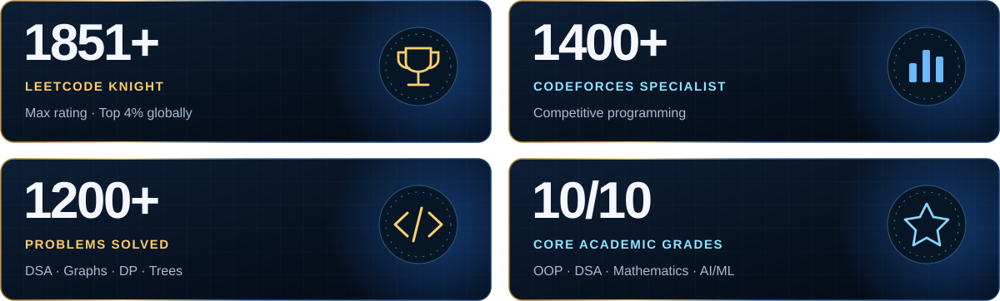
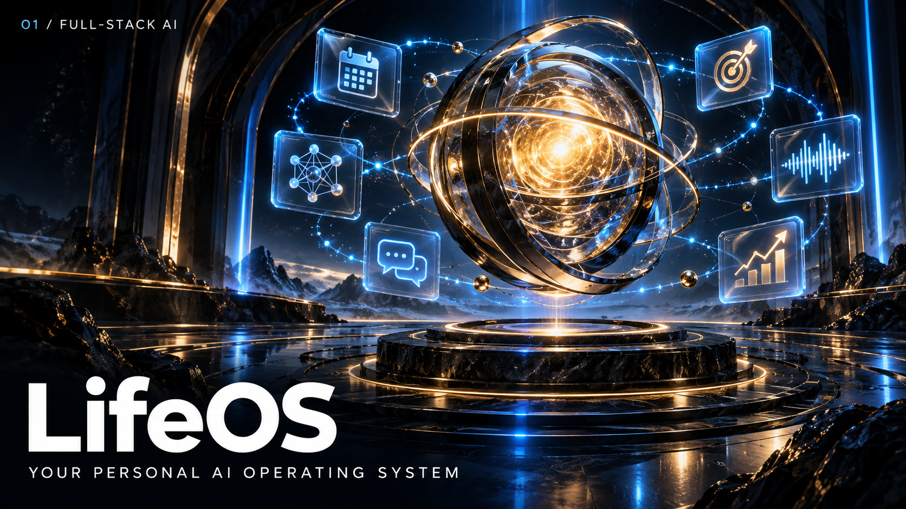
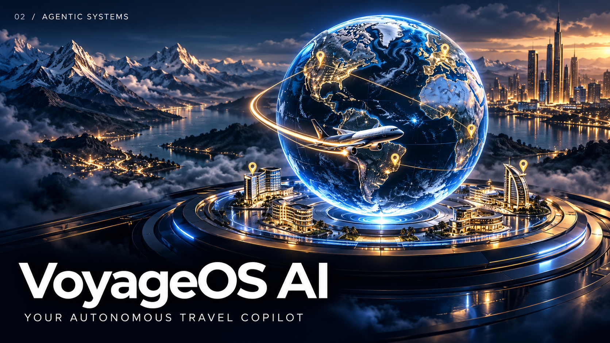
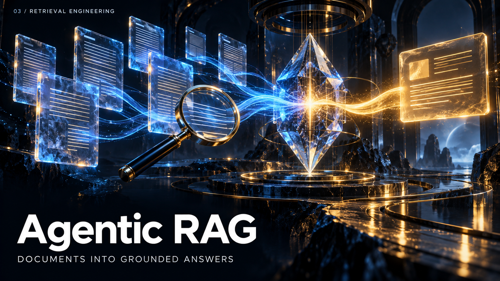
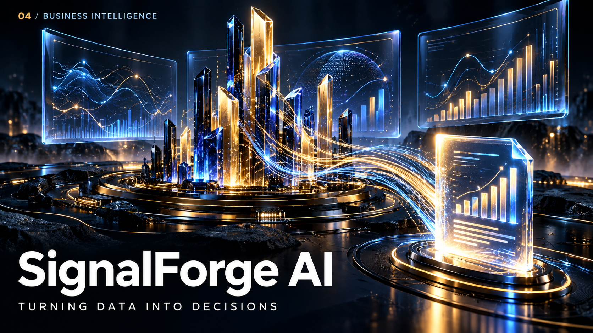
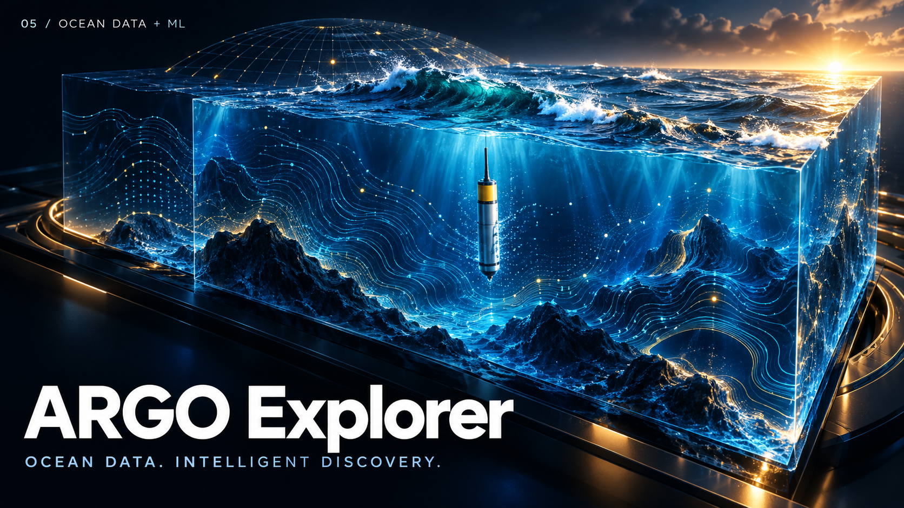
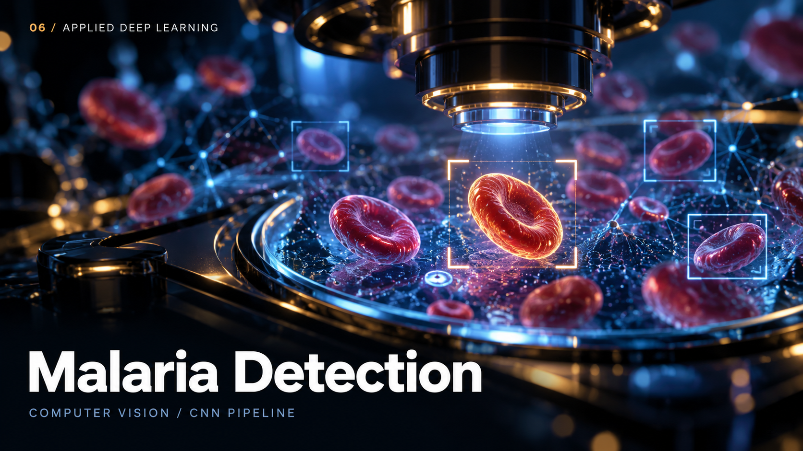
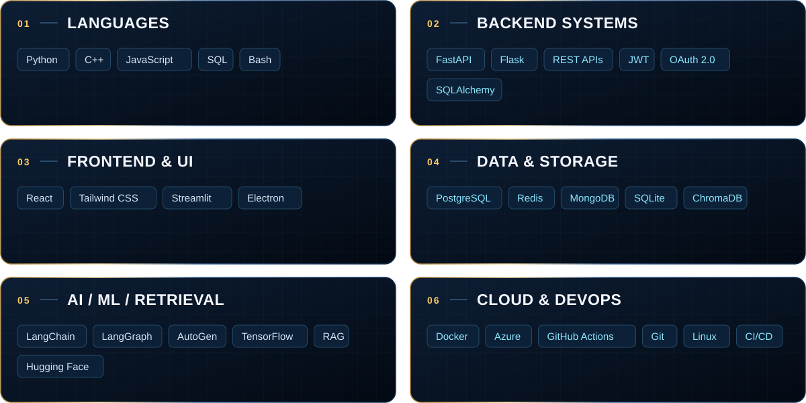
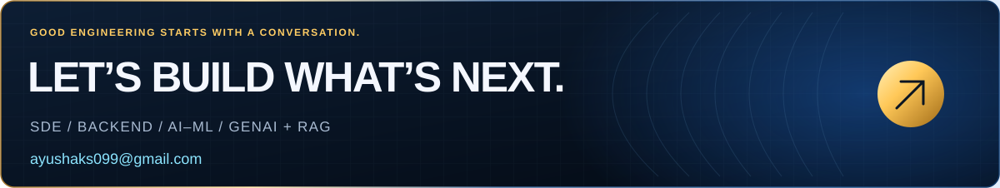

  
  
  
  

  <b>Engineering useful software. Building intelligent experiences.</b> 
  Computer Science @ NIT Durgapur · Class of 2027 · Open to internships &amp; collaborations

  <a href="#about-me">About</a> &nbsp; / &nbsp;
  <a href="#selected-projects">Projects</a> &nbsp; / &nbsp;
  <a href="#tech-stack">Tech stack</a> &nbsp; / &nbsp;
  <a href="#achievements--education">Achievements</a> &nbsp; / &nbsp;
  <a href="#lets-connect">Contact</a>

About me
I’m Ayush Kumar Shaw, a B.Tech Computer Science undergraduate at NIT Durgapur, building backend systems, full-stack AI products, and applied ML solutions.
I enjoy owning the complete engineering process: architecture → implementation → evaluation → deployment. My work brings together APIs, authentication, databases, retrieval, agent workflows, and interfaces that make complex systems useful.
- Backend engineering: REST APIs, authentication, persistent storage, streaming, and modular services.
- AI systems: Agentic RAG, multi-agent workflows, semantic search, reranking, and grounded answers.
- Applied ML: Forecasting, classification, computer vision, and reproducible evaluation pipelines.
- CS fundamentals: Data structures, algorithms, system design, and competitive programming.

  

Selected projects
Full-stack AI, agentic systems, retrieval, and applied machine learning.
<table>
<tr>
<td width="50%" valign="top">

<h3>LifeOS</h3>

<b>Personal AI operating system</b>

One workspace for assistant chat, memory, tasks, goals, planning, reminders, and finance.

<b>Architecture &amp; features</b>

<ul>
<li>Gmail, Calendar, and connected integrations</li>
<li>Music and voice interaction</li>
<li>JWT and OAuth 2.0 authentication</li>
</ul>

<code>FastAPI</code> <code>React</code> <code>PostgreSQL</code> <code>Redis</code> <code>Groq</code> <code>Docker</code>

<a href="https://github.com/ayushaks9990/LifeOSs"><b>Explore LifeOS →</b></a>

</td>
<td width="50%" valign="top">

<h3>VoyageOS AI</h3>

<b>Autonomous travel copilot</b>

An AI vacation planner that turns a source, destination, and preferences into a complete trip.

<b>Architecture &amp; features</b>

<ul>
<li>Multi-agent planning and destination recommendations</li>
<li>Flight and hotel discovery, with budget optimization</li>
<li>Personalized day-by-day itineraries</li>
</ul>

<code>FastAPI</code> <code>React</code> <code>Groq</code> <code>Google Places</code> <code>Amadeus</code> <code>PostgreSQL</code> <code>Docker</code>

<a href="https://github.com/ayushaks9990/Voyageos"><b>Explore VoyageOS AI →</b></a>

</td>
</tr>
<tr>
<td width="50%" valign="top">

<h3>Agentic Multi-PDF RAG</h3>

<b>Retrieval with grounding and feedback</b>

A multi-user document QA platform with persistent conversations, semantic retrieval, and streaming answers.

<b>Architecture &amp; features</b>

<ul>
<li>Token-aware PDF ingestion and optional OCR</li>
<li>Feedback-driven reranking and experimental visual reranking</li>
<li>Source snippets, web fallback, and deployment support</li>
</ul>

<code>Python</code> <code>Streamlit</code> <code>LangChain</code> <code>Gemini</code> <code>ChromaDB</code> <code>SQLite</code> <code>Docker</code> <code>Azure</code>

<a href="https://github.com/ayushaks9990/RaG_Chatbot"><b>Explore Agentic RAG →</b></a>

</td>
<td width="50%" valign="top">

<h3>SignalForge AI</h3>

<b>AI sales &amp; marketing report generator</b>

An authenticated business-intelligence platform that transforms sales and marketing data into useful analysis.

<b>Architecture &amp; features</b>

<ul>
<li>Live analytics and polished visualizations</li>
<li>Agentic analysis and executive-ready AI reports</li>
<li>Full-stack architecture with deployment support</li>
</ul>

<code>FastAPI</code> <code>React</code> <code>PostgreSQL</code> <code>Groq</code> <code>RAG</code> <code>Docker</code>

<a href="https://github.com/ayushaks9990/ReporT"><b>Explore SignalForge AI →</b></a>

</td>
</tr>
<tr>
<td width="50%" valign="top">

<h3>ARGO RAG Explorer</h3>

<b>Oceanographic data, made queryable</b>

An ML + RAG platform for turning ARGO NetCDF sensor data into structured, searchable datasets.

<b>Architecture &amp; features</b>

<ul>
<li>NetCDF ingestion and SQL-ready storage</li>
<li>Scientific visualization and RAG exploration</li>
<li>Forecasting workflows with multiple ML models</li>
</ul>

<code>Python</code> <code>Streamlit</code> <code>LangChain</code> <code>ChromaDB</code> <code>SQLAlchemy</code> <code>XGBoost</code> <code>LightGBM</code>

<a href="https://github.com/ayushaks9990/OceanForge_AI"><b>Explore ARGO →</b></a>

</td>
<td width="50%" valign="top">

<h3>Malaria Detection Pipeline</h3>

<b>Applied computer vision</b>

An image-classification project covering preprocessing, CNN training, and evaluation.

<b>Architecture &amp; features</b>

<ul>
<li>Structured image preprocessing</li>
<li>TensorFlow CNN classification</li>
<li>Evaluation metrics and visual diagnostics</li>
</ul>

<code>Python</code> <code>TensorFlow</code> <code>CNN</code> <code>OpenCV</code>

<a href="https://github.com/ayushaks9990/Malaria_Prediction"><b>Explore the pipeline →</b></a>

</td>
</tr>
</table>

<b>More projects · meeting intelligence &amp; voice interaction</b>

<h3>AI Meeting Summarizer</h3>

A desktop app for recording meetings, transcribing audio, generating summaries, and extracting action items. Includes task priorities and assignees, notifications, search, audio playback, and local meeting history.

<b>Stack:</b> Electron · Python · Flask · Flask-SocketIO · SQLAlchemy · SQLite · Deepgram · LLM APIs

<a href="https://github.com/ayushaks9990/AI-Meeting-Summarizer">Explore AI Meeting Summarizer →</a>

<h3>Voice Assistant</h3>

Voice and chat interaction for general Q&amp;A, YouTube music playback, weather updates, and reminders. Built with a modular backend for speech, music, weather, and notification workflows.

<b>Stack:</b> Python · Flask · Groq · Open-Meteo · yt-dlp · VLC · Speech Recognition

<a href="https://github.com/ayushaks9990/Assistant#voice-assistant-project">Explore Voice Assistant →</a>

<b>Inside the RAG system · retrieval, learning &amp; deployment</b>

<ul>
<li><b>Ingestion:</b> Multi-PDF uploads, token-aware chunking, optional OCR, and a document registry.</li>
<li><b>User isolation:</b> PBKDF2-SHA256 password hashing, per-user chats, uploads, and feedback.</li>
<li><b>Retrieval:</b> Persistent ChromaDB semantic search and source-grounded snippets.</li>
<li><b>Learning:</b> A feedback-driven incremental reranker using <code>SGDClassifier</code>.</li>
<li><b>Experiments:</b> ColPali / ColQwen hybrid visual reranking.</li>
<li><b>Answers:</b> Streaming responses, confidence signals, and Tavily web fallback.</li>
<li><b>Deployment:</b> Docker support and Azure deployment readiness.</li>
</ul>

Tech stack

<b>Full technology stack &amp; CS fundamentals</b>

<table>
<thead><tr><th>Area</th><th>Technologies</th></tr></thead>
<tbody>
<tr><td><b>Languages</b></td><td>Python · C++ · JavaScript · SQL · Bash</td></tr>
<tr><td><b>Frontend &amp; interfaces</b></td><td>React · Tailwind CSS · Streamlit · Electron</td></tr>
<tr><td><b>Backend &amp; APIs</b></td><td>FastAPI · Flask · REST APIs · SQLAlchemy · JWT · OAuth 2.0 · Streaming · Socket.IO</td></tr>
<tr><td><b>Databases &amp; storage</b></td><td>PostgreSQL · SQLite · MongoDB · Redis · ChromaDB · Vector databases</td></tr>
<tr><td><b>Agentic AI &amp; retrieval</b></td><td>LangChain · LangGraph · AutoGen · RAG · LLM orchestration · Semantic search · Reranking</td></tr>
<tr><td><b>ML &amp; deep learning</b></td><td>TensorFlow · Scikit-learn · XGBoost · LightGBM · Transformers · Hugging Face · OpenCV</td></tr>
<tr><td><b>Cloud &amp; development</b></td><td>Docker · Azure · GitHub Actions · Git · Linux · CI/CD</td></tr>
<tr><td><b>CS fundamentals</b></td><td>DSA · OOP · System design · DBMS · Computer networks · Computer organization &amp; architecture · Software engineering</td></tr>
</tbody>
</table>

<b>ML areas I work with</b>

Forecasting · Classification · Computer vision · CNNs · R-CNN · YOLO · NLP · LSTMs · Transformers · Model evaluation

Achievements & education
National Institute of Technology, Durgapur
B.Tech in Computer Science and Engineering · 2023–2027
LeetCode Knight · Codeforces Specialist · 1200+ problems solved
LeetCode profile →   ·   Codeforces profile →

<b>Ratings, academic achievements &amp; education</b>

<table>
<thead><tr><th>Area</th><th>Highlights</th></tr></thead>
<tbody>
<tr><td><b>LeetCode</b></td><td><b>Knight</b> · Max rating <b>1851+</b> · <b>Top 4%</b> globally · <a href="https://leetcode.com/u/ayushaks9999/">Profile</a></td></tr>
<tr><td><b>Codeforces</b></td><td><b>Specialist</b> · <b>1400+</b> rating · <a href="https://codeforces.com/profile/ayushaks999">Profile</a></td></tr>
<tr><td><b>Problem solving</b></td><td><b>1200+ problems</b> across arrays, graphs, DP, trees, greedy, binary search, and advanced data structures</td></tr>
<tr><td><b>Core academics</b></td><td><b>10/10 grades</b> in OOP, DSA, Mathematics, AI/ML, Software Engineering, and Embedded Systems</td></tr>
<tr><td><b>JEE Main</b></td><td><b>Top 1%</b></td></tr>
<tr><td><b>University</b></td><td><b>National Institute of Technology, Durgapur</b> · B.Tech in Computer Science and Engineering · <b>Aug 2023 – Jun 2027</b></td></tr>
<tr><td><b>School</b></td><td><b>Delhi Public School, Durgapur</b> · Graduated <b>May 2022</b></td></tr>
</tbody>
</table>

Let’s connect
I’m open to SDE, backend, AI/ML, and GenAI / RAG internships, as well as collaborations on useful engineering projects.
If you’re working on retrieval, agent workflows, backend architecture, or an intelligent product, I’d love to connect.

  <a href="mailto:ayushaks099@gmail.com"><b>ayushaks099@gmail.com</b></a>  
  <a href="https://ayushshaw-nitdgp.vercel.app">Portfolio</a> &nbsp; · &nbsp;
  <a href="https://linkedin.com/in/ayush-shaw-231b86325">LinkedIn</a> &nbsp; · &nbsp;
  <a href="https://github.com/ayushaks9990?tab=repositories">Repositories</a> &nbsp; · &nbsp;
  <a href="https://github.com/ayushaks9990?tab=overview">GitHub activity</a>

